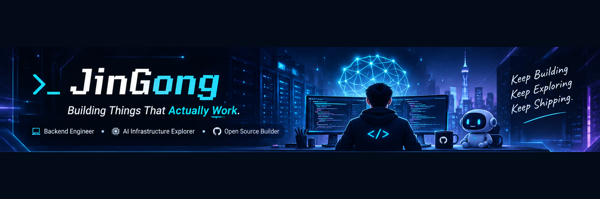

# 👋 Hey, I'm JinGong

### Backend Engineer · AI Infrastructure Explorer · Open Source Builder

  

  <strong>Building Things That Actually Work.</strong>

  
  
  
  

---

## `$ whoami`

I'm a software engineer with **9 years of development experience**, focused on backend engineering, AI infrastructure, and practical software development.

I enjoy exploring new technologies through hands-on projects and turning engineering ideas into reliable products.

- 🚀 Building AI infrastructure and developer tools with Go.
- 🤖 Exploring LLM serving, GPU computing, and AI Agents.
- ☁️ Working with Docker, Kubernetes, and cloud-native architecture.
- ✍️ Sharing engineering practices and open-source projects.

---

## `$ ls ./featured-projects`

### 🚀 Featured Projects

<table>
<tr>

<td width="33%" valign="top">

### 🖥️ SuiDemo

**Modern Desktop App Starter**

A modern desktop application template powered by Go and Vue 3.

- Wails 3
- Vue 3
- TypeScript
- Tailwind CSS
- SQLite

`Go` `Vue 3` `Wails 3`

  

</td>
<td width="33%" valign="top">

### 🌐 AI Gateway

**Enterprise AI Gateway**

A Go-based gateway for unified access and governance of multiple LLM services.

- Multi-tenant Architecture
- Authentication
- Rate Limiting
- Quota Management
- Model Routing
- Streaming Proxy

`Go` `Gin` `LLM`

  

</td>
<td width="33%" valign="top">

### 🔥 RiForge

**LLM Deployment Pipeline**

Automate the LLM deployment workflow from model downloading to quantization and serving.

- Model Download
- AWQ Quantization
- Docker Deployment
- vLLM Integration

`Go` `Python` `Docker`

  

</td>
</tr>
</table>

---

## `$ cat ./tech-stack.json`

### 🛠️ Tech Stack

**Languages**

  

**Backend & Application Development**

  

**AI & Infrastructure**

  

**AI Engineering**

`LLM` `vLLM` `Ollama` `AWQ` `CUDA` `AI Gateway` `AI Agents`

---

## `$ ./currently-exploring.sh`

### 🔬 Currently Exploring

<table>
<tr>
<td width="33%" valign="top">

**AI Infrastructure**

- LLM Serving
- GPU Optimization
- vLLM & KV Cache
- Kubernetes + GPU

</td>
<td width="33%" valign="top">

**Enterprise AI Gateway**

- Multi-tenancy
- Authentication
- Rate Limiting
- Model Routing
- Observability

</td>
<td width="33%" valign="top">

**AI Applications**

- Agent Architecture
- Tool Calling
- RAG
- Knowledge Base
- Enterprise AI Platform

</td>
</tr>
</table>

---

## `$ git status`

### 📊 GitHub Statistics

## 📊 GitHub Statistics

  

  

  

---

## `$ cat philosophy.md`

### 💡 Engineering Philosophy

> Don't just learn technologies. Build something with them.
>
> Don't just make it work. Make it reliable.
>
> Don't just consume knowledge. Share what you build.

  <strong>Keep Building. Keep Exploring. Keep Shipping. 🚀</strong>

  

